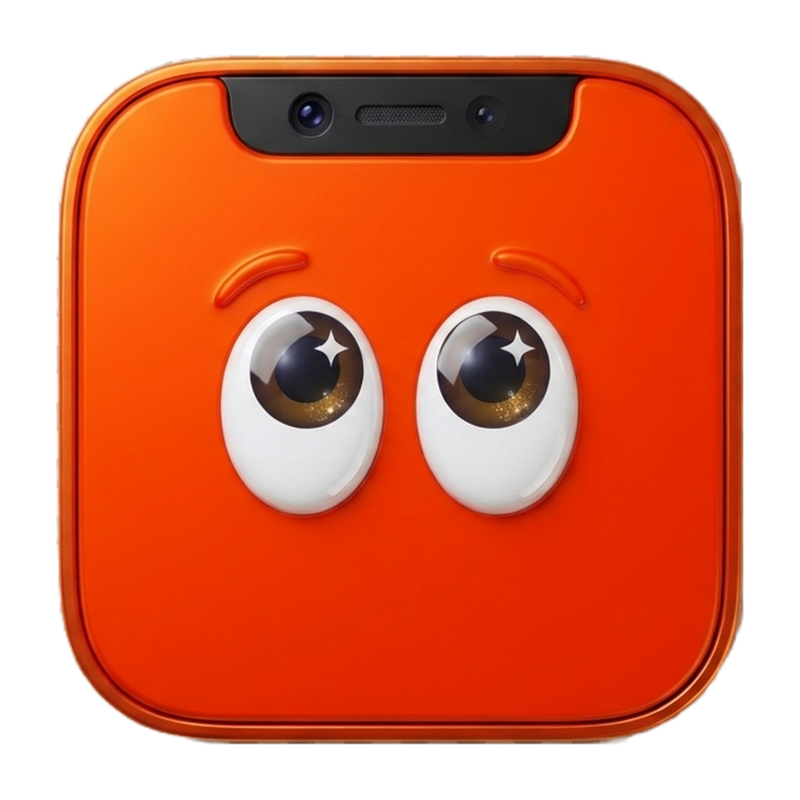

<div align="center">

  
</div>

# MacPrompt

**A native macOS teleprompter that keeps your words right where you look.**

MacPrompt is a lightweight **macOS teleprompter app** for presentations, video recording, content creation, public speaking, and everyday workflows. It combines smooth scrolling, speech recognition, script management, and seamless Mac notch integration in a focused native experience.

## ✨ Features

- 🎬 Smooth scrolling teleprompter
- 🎙️ Speech recognition & Follow My Words
- 🖥️ Mac notch integration
- 📜 Script management, folders & search
- ⌨️ Keyboard shortcuts
- 🔤 Rich text, font & formatting controls
- ⏱️ Countdown and playback controls
- 🪞 Mirrored teleprompter mode
- 🎤 Microphone selection & voice level
- 🌓 Light & Dark Mode
- 🖥️ Multi-display support
- ⚙️ Native macOS settings and controls

## 🚀 Build

MacPrompt is built natively with **Swift and Xcode**.

```bash
git clone https://github.com/vanshja1n/MacPrompt.git
cd MacPrompt
open MacPrompt.xcodeproj
```

Select the **MacPrompt** scheme in Xcode and build/run the app.

## 🎯 Built For

MacPrompt is useful for:

- Content creators
- YouTubers & video creators
- Presenters and speakers
- Podcasters
- Online meetings
- Tutorials and demonstrations
- Anyone who needs a simple Mac teleprompter

## 🔐 Permissions

Some features may require macOS permissions for:

- Microphone
- Speech Recognition

Permissions can be managed from **System Settings → Privacy & Security**.


---

**MacPrompt — Your words. Right where you look.**
